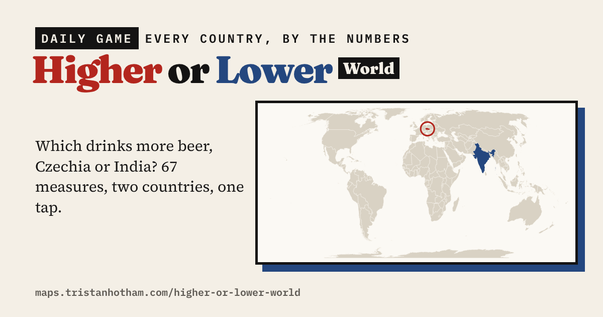

# Higher or Lower: World

A daily game of two countries and one number. Which drinks more beer, has more islands, has won more Olympic medals or grows more bananas? **[Play it](https://maps.tristanhotham.com/higher-or-lower-world/)**

## How it works

- You see two countries, a question and a small map. Tap the one you think is higher, and both numbers count up with each country's rank and the source.
- **Today's 10** is the same ten pairs for everyone each day, with at least three Just for fun questions, and a row of squares to share at the end. The pairs are worked out in your browser from the date, so there is a new set every day.
- **Endless** keeps going until you get one wrong, and the pairs get closer the longer your streak runs. You can stick to one topic.

There are 67 measures in six groups: People; Money and work; Food and drink; Land and weather; Getting about; and Just for fun (Olympic medals, World Cup appearances, Nobel laureates, IKEA stores, McDonald's per person, Eurovision wins, Miss Universe titles, islands, time zones, earthquakes, heliports, nuclear reactors and merchant ships).

The places are the world's 196 sovereign countries (the 193 UN members plus Kosovo, Taiwan and Vatican City). Not every country has every figure, so each question only uses the countries that have one, and pairs too close to call are never asked. The UK version, with 66 measures for every council, is [Higher or Lower](https://github.com/Tristan-Hotham/higher-or-lower).

## Files

- `index.html`: the game (one page, no build step)
- `data.json`: the countries and the 67 measures, with sources
- `data.csv`: the same figures as a table, one row per country
- `map.json`: simplified country boundaries (Natural Earth) on an Equal Earth projection
- `code/`: the Python scripts that build the data (`hol_world.py` is the main one)

## Sources

- **CIA World Factbook** (public domain), via the [factbook.json](https://github.com/factbook/factbook.json) mirror: population, area, median age, life expectancy, fertility, urbanisation, GDP per person, unemployment, public debt, military spending, household spending on food, internet and mobile use, alcohol and tobacco, obesity, coastline, elevation, forest, airports, heliports, railways, merchant ships and nuclear reactors.
- **Our World in Data** (CC BY 4.0): FAO food supply and crop production, World Happiness Report, NCD-RisC height, Penn World Table working hours, World Bank air passengers and UN Tourism arrivals.
- **UNESCO World Heritage Centre**: World Heritage Sites by country.
- **US Geological Survey** earthquake catalogue: earthquakes of magnitude 6 or more since 1900, counted for the country they struck or the nearest country within about 100 km.
- **Wikipedia** lists (CC BY-SA 4.0): Olympic medals, World Cup appearances, Nobel laureates, billionaires, McDonald's, IKEA, beer and tea drinking, vehicles, temperature, rainfall, islands, languages, time zones, potato production, Eurovision and Miss Universe.
- **GeoNames** (CC BY 4.0): land neighbours. **Natural Earth** (public domain): boundaries.

Figures are the latest each source gives, so years differ between measures, and some are estimates. The Just for fun counts measure what has been recorded.

## Licence

Code: MIT. Data: CC BY 4.0, except values from Wikipedia lists, which are CC BY-SA 4.0. Keep the attributions above.

Dr Tristan Hotham, independent researcher · 2026 · [tristanhotham.com](https://tristanhotham.com)

AI use: built with coding and drafting help from Claude (Anthropic). I reviewed and checked the data and text.
